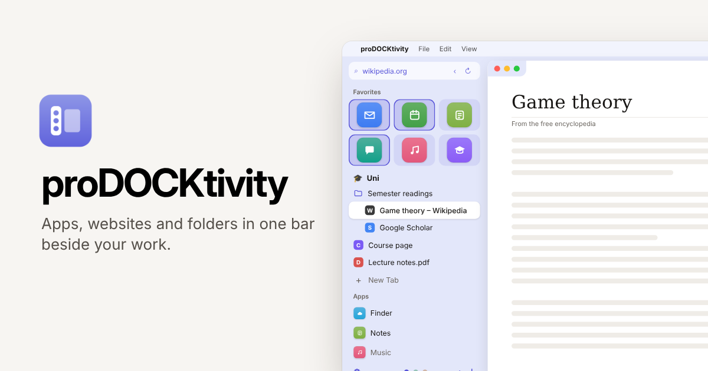
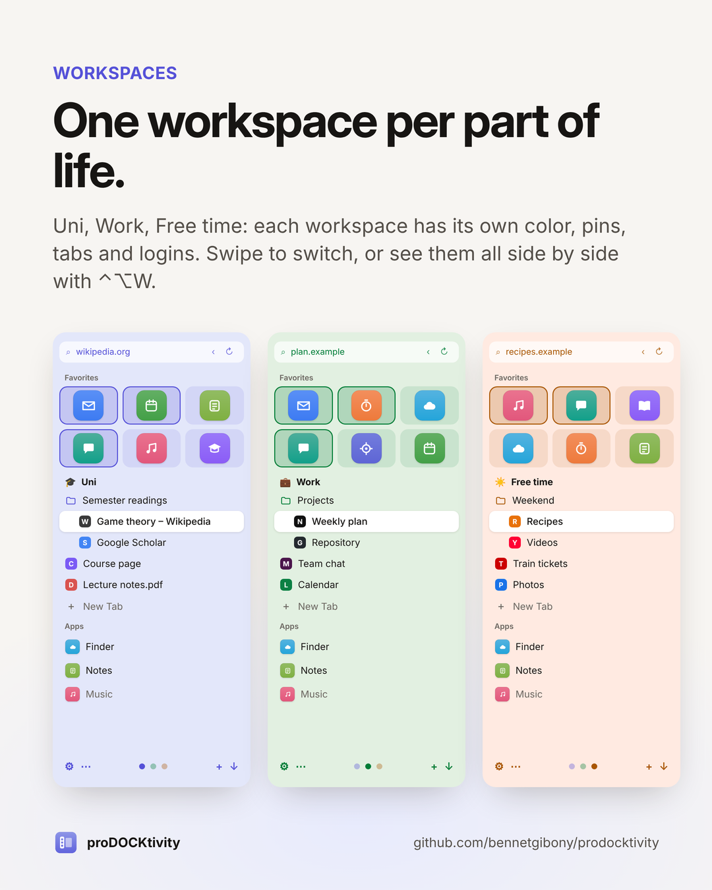
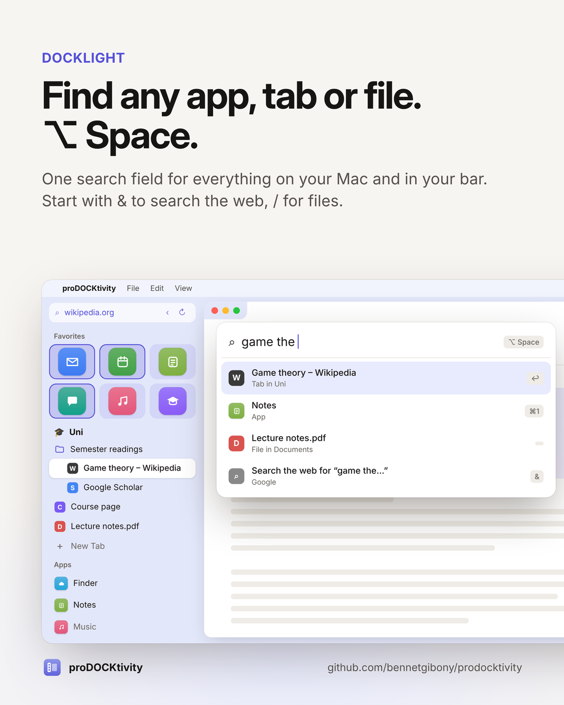

<p align="center"></p>

# proDOCKtivity

**Apps, websites and folders in one bar beside your work, sorted into workspaces.**

proDOCKtivity is a macOS app that replaces the jumble of Dock, browser tabs and Finder windows with one bar on the left edge of the screen. Pin your apps, websites and folders, group them into workspaces (for example Uni, Work, Free time), and click anything to open it right next to the bar.

[**Download the latest release**](https://github.com/bennetgibony/prodocktivity/releases/latest) · [Website](https://prodocktivity.bennet-gibony.com) · [Feedback](mailto:prodocktivity@bennet-gibony.com)

> Mockups in this README use demo content.

## Features

- **Workspaces.** Each workspace (Uni, Work, Free time …) has its own color, pinned apps, websites and folders, open tabs and logins. Swipe with two fingers to switch, or press `⌃⌥W` to see them all side by side and drag things between them.
- **Built-in browser.** Websites open in proDOCKtivity's own window beside the bar, with tabs and logins per workspace, incognito tabs, per-site zoom and your choice of search engine. Chrome or Arc can be used instead.
- **Extensions.** uBlock Origin Lite with one click, the Zotero Connector, Bitwarden, and Chrome/Firefox-style extensions from a folder, `.zip`, `.xpi` or `.crx`.
- **DOCKlight** (`⌥ Space` or `⌃⌥ Space`; `⌘ Space` stays Spotlight's). One search field for apps, open tabs and files. Start with `&` to search the web, `/` for files only.
- **Window snapping, split and freeze.** Everything you open fills the space beside the bar. `⌥`-click for split screen, `⌃`-click to freeze one thing on a half while you switch the other, and set rules for where each app's windows go.
- **Undo.** `⌘Y` reopens the last closed tab or app (`⌃⌥Y` from any app). Deleting a workspace or profile never asks first: a note offers Undo instead.
- **Auto-Quit.** Apps and tabs you haven't used for a while are hidden or closed, with their own rules for Favorites and for each workspace, and exceptions for the ones you need.
- **Set up in a minute.** A first-start tour offers a quick recommended setup or step-by-step choices. Setup files copy your workspaces and settings to another Mac.
- **Red dots.** Notification badges for apps and websites, right in the bar.
- **Docks and frame.** A second bar for websites, a files dock for your folders, and a frame in the workspace's color that makes it all feel like one window.
- **Ideas inbox.** `⌃⌥I` jots a thought into one plain text file.
- **Your data stays yours.** No account and no analytics. Settings › Data shows where everything lives, makes a daily backup (kept 14 days) and exports everything as JSON and CSV.

<p align="center"> </p>

## Requirements

- macOS 27 or newer
- A Mac with Apple silicon (M1 or newer)

## Install

1. Download `proDOCKtivity.zip` from the [latest release](https://github.com/bennetgibony/prodocktivity/releases/latest) and double-click it.
2. Move **proDOCKtivity** into your Applications folder and open it.
3. The app isn't from the App Store, so macOS blocks the first launch. Open **System Settings › Privacy & Security** and click **Open Anyway** (once).
4. The **setup tour** opens (about a minute). Pick **Quick setup** for good settings and three workspaces, or go step by step.
5. Allow **Accessibility** when asked, so windows can snap beside the bar.
6. `⌃⌥S` shows and hides the bar at any time.

The release includes a **Setup Guide** and a **What's New** page with every step and setting explained.

## Build from source

Only the Xcode **Command Line Tools** are needed (no full Xcode):

```sh
xcode-select --install          # once
./scripts/test.sh               # run the test suite
./scripts/build-app.sh          # build, install to /Applications and relaunch
./scripts/build-app.sh --no-install
./scripts/package.sh            # dist/proDOCKtivity.zip with Setup Guide and What's New
```

Builds are ad-hoc signed. Every rebuild changes the signature, so macOS may ask for Accessibility access again. `scripts/create-signing-identity.sh` creates a local signing certificate that keeps the permission across rebuilds.

## Project layout

| Path | What's there |
|---|---|
| `Sources/ArcSidebar/` | The app (Swift, AppKit + SwiftUI). The target is still called ArcSidebar, its original name. |
| `Sources/ArcSidebar/Views/Theme.swift` | Every design value: colors, accents, space colors, spacing, type, motion |
| `Tests/ArcSidebarTests/` | Tests (Swift Testing) |
| `Resources/` | Info.plist, app icon, String Catalog, Setup Guide and What's New |
| `scripts/` | Build, test, package, icon and string tools |
| `DESIGN.md` | Icons and what each mark in the bar means |

## Privacy

- Websites you open get what any browser sends them; searches go to the search engine you choose.
- Icons for websites in the bar come from Google's favicon service, which sees those sites' domain names. If Google has no icon, the site's own icon is fetched from the site.
- Every few hours the app asks GitHub whether a newer version exists. GitHub sees your IP address; nothing else is sent. A found update is only installed when you click Update.
- Ideas are only sent when you choose to email them, from your own mail app.
- Nothing goes to any analytics service.

## License

proDOCKtivity is **source-available** under the [PolyForm Noncommercial License 1.0.0](LICENSE).

- ✅ You may use, study, change and share it for **personal, educational, research and other noncommercial** purposes, and nonprofits may use it too.
- ❌ You may **not** use it, or anything built from it, for commercial purposes, such as selling it or bundling it in a paid product.

For commercial use, write to [prodocktivity@bennet-gibony.com](mailto:prodocktivity@bennet-gibony.com).

Because it restricts commercial use, this license isn't "open source" in the OSI sense.

## Feedback

Security problems: see [SECURITY.md](SECURITY.md). Ideas and bug reports are welcome as [GitHub issues](https://github.com/bennetgibony/prodocktivity/issues) or by email to [prodocktivity@bennet-gibony.com](mailto:prodocktivity@bennet-gibony.com). Inside the app, `⌃⌥I` collects ideas and **⋯ › Ideas & Wishes › Email Ideas** sends them.

---

Made by [Bennet Gibony](https://bennet-gibony.com) with Claude.
